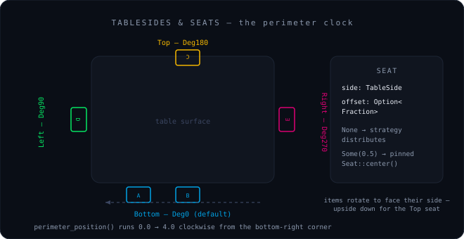

# TableSides & Seats

The crate's core vocabulary: which edge of the table an item faces,
and where along that edge it belongs.

<figure class="diagram">
  
  <figcaption>items rotate to face their side — upside down for the Top seat</figcaption>
</figure>

## `TableSide`

The four edges, tied to geometry's `QuarterTurn`: `Bottom` = `Deg0`,
`Left` = `Deg90`, `Top` = `Deg180`, `Right` = `Deg270` — each side owns
a 90° sector centered on its orientation.

```rust
use smearor_commons_layout::TableSide;
use smearor_commons_geometry::{RotationRad, Vec2};

TableSide::ALL;                          // [Bottom, Left, Top, Right] — clockwise
TableSide::Bottom.clockwise();           // Left
TableSide::Left.to_quarter_turn();       // QuarterTurn::Deg90
TableSide::Left.right_direction::<()>(); // Vec2(1.0, 0.0) — reading direction

// snap helpers — orientation and position variants
TableSide::nearest(RotationRad::new(0.6));            // Left (34° → 90° sector)
TableSide::nearest_edge(marker_pos, table_bounds);    // closest edge by distance
```

`nearest` resolves exact sector boundaries (45°/135°/…) to the
clockwise-next side; `nearest_edge` derives a side from a physical
position — ties resolve to `Bottom` first, in `ALL` order.
`anchor_weights()` translates a side into the matching
`AnchorWeights` corner for flow-style anchoring.

## `SideSet` — several sides at once

A non-empty bitmask set of `TableSide`s — `EdgeStripLayout` takes its
edge selection as a `SideSet` so "at least one side" is a type-level
invariant, not a convention:

```rust
use smearor_commons_layout::{SideSet, TableSide};

let sides = SideSet::try_from_sides([TableSide::Bottom, TableSide::Left])?;
sides.contains(TableSide::Left);   // true
sides.len();                       // 2 — always 1..=4
SideSet::ALL;                      // all four
```

Membership and `iter()` follow the clockwise `TableSide::ALL` order,
so iteration is deterministic regardless of construction order; serde
is a list of side names (`["bottom","left"]`). An empty selection
reports `LayoutError::EmptySides`.

## `Seat` — side plus optional edge offset

```rust
use smearor_commons_layout::Seat;
use smearor_commons_geometry::Fraction;

Seat::new(TableSide::Left);                     // side only — strategy distributes
Seat::at(TableSide::Bottom, Fraction::new(0.3)); // pinned 30% along the edge
Seat::center(TableSide::Top);                    // pinned at HALF
```

`offset` is `None` or `Some(Fraction)` (`0.0` = edge start). The `None`
case matters: it says *"assigned to this side, spread me with the
others"* rather than *"center me"*.

## Perimeter navigation

`perimeter_position()` maps a seat to `0.0..4.0` — the bottom edge
`0..1` (right-to-left), left `1..2` (bottom-to-top), top `2..3`
(left-to-right), right `3..4` (top-to-bottom). Continuous at the
corners, so `next_in`/`previous_in` walk a roster clockwise and
counter-clockwise, skipping empty sides.

## Placement in front of a seat

```rust
seat.placement(bounds, footprint, margin)
// centered on the seat's edge position, `margin` off the edge,
// rotated to the side's quarter turn

seat.fanned_placement(bounds, footprint, margin, &taken, gap)
// like placement(), but picks the free spot nearest the seat —
// reuses gaps in the edge lane, may land a row behind when the
// lane is full
```

`margin`/`gap` take `impl Into<Distance<U>>` — a bare `f64` reads as
the `bounds` coordinate space, a `Distance<Millimeters>` carries its
unit into the call.

## `SeatPose` — a seat with a face

`Seat { side, offset }` says *where*; `SeatPose { seat, orientation:
RotationRad }` adds *which way the user faces* — a free angle, not
snapped to the side's quarter turn. It offers the same navigation
(`perimeter_position`, `next_in`, `placement`, `fanned_placement`), so
consumers that model users-as-poses get identical ergonomics.

Wire note: `Seat`/`SeatPose` deliberately have no `zvariant` impl —
`Option<Fraction>` has no D-Bus signature. They travel as `(TableSide,
f64)` / `(TableSide, f64, f64)` triples with `NaN` for the unpinned
offset.
