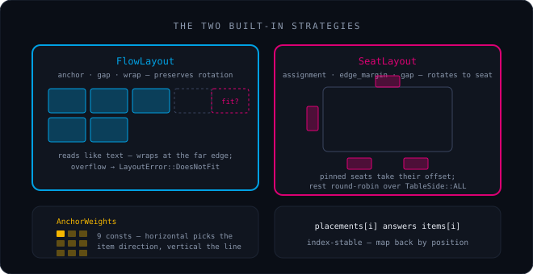

# Strategies

`LayoutStrategy<U>` is the contract — a pure function mapping
`LayoutItem`s onto `Placement`s inside `bounds`. Strategies see
footprints, never widgets or domain objects, so any crate can
implement one and hand it to a shared caller.

<figure class="diagram">
  
  <figcaption>flow reads like text; seat layout arranges around the perimeter</figcaption>
</figure>

```rust
pub trait LayoutStrategy<U> {
    fn arrange(&self, bounds: Rect<U>, items: &[LayoutItem<U>])
        -> Result<Vec<Placement<U>>, LayoutError>;
}
```

**Index-stable**: `placements[i]` answers `items[i]` — the caller maps
back by position. Everything is unit-generic over `U`: the same
strategy arranges a pixel canvas or a physical millimeter table.

## `FlowLayout` — anchored rows

```rust
use smearor_commons_layout::{AnchorWeights, FlowLayout};

let flow = FlowLayout {
    anchor: AnchorWeights::TOP_LEFT,   // corner the flow starts from
    gap: 24.0,                          // between items and between lines
    wrap: true,                         // wrap to the next line at the far edge
};
// Default::default() → TOP_LEFT, gap 24, wrap on
```

Non-overlapping rows starting at `anchor` — `horizontal` picks the
item direction, `vertical` the line direction. `wrap = false` means a
single line; an overflowing item reports `DoesNotFit`. The item's own
`rotation` is preserved.

## `SeatLayout` — around the table

```rust
use smearor_commons_layout::SeatLayout;

let seats = SeatLayout {
    assignment: SeatAssignment::RoundRobin,   // for items without a seat
    edge_margin: 24.0,                        // distance off the table edge
    gap: 24.0,                                // between items on one side
};
```

Per side: **pinned** seats (`Seat::at`) take their exact offset;
**unpinned** items spread along the edge centered as a group, each
`edge_margin` off the edge, **rotated to the side's orientation** —
footprints computed via `footprint_for` at the target quarter turn.
A spread group wider than its edge reports `DoesNotFit`.

`SeatAssignment::RoundRobin` distributes items without a seat over
`TableSide::ALL` in input order — item `i` lands on `ALL[i % 4]`.

## `AnchorWeights` — the 9-point grid

```rust
AnchorWeights::TOP_LEFT;     // horizontal 0.0, vertical 0.0
AnchorWeights::CENTER;       // 0.5 / 0.5
AnchorWeights::BOTTOM_RIGHT; // 1.0 / 1.0
```

Two `Fraction`s selecting one of nine anchors — corners, edge centers
and center. `TableSide::anchor_weights()` maps a side to its
matching anchor for consumers that blend flow and seat semantics.

## `LayoutError::DoesNotFit`

```rust
#[error("item {index} of {items} does not fit inside the bounds")]
DoesNotFit { index: usize, items: usize }
```

The strategy reports the first item that failed; the consumer decides
the reaction — retry with different options, shrink items, or leave
the overflow unarranged. Layout never silently overlaps.
