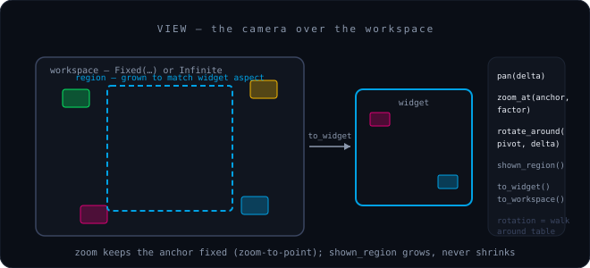

# Workspace & View

Two separate concerns the crate keeps distinct: how big the item
world is (`WorkspaceSize`), and which part of it the widget shows
(`View`).

## `WorkspaceSize<U>` — how big is the table

```rust
use smearor_commons_layout::WorkspaceSize;

WorkspaceSize::FollowWidget;   // workspace == widget allocation (default)
WorkspaceSize::Fixed(Vec2::new(1920.0, 1080.0)); // fixed extent, origin (0,0)
WorkspaceSize::Infinite;       // unbounded — items may live anywhere
```

`extent(widget_extent)` resolves to `Option<Rect>` — `Infinite` yields
`None`. With no edge to clamp against, consumers typically clamp to
the visible `View` region so items can't be lost off-screen.

## `View<U>` — the camera

`View` is `region: Rect<U>` (the workspace area requested visible)
plus `rotation: RotationRad` (the workspace's rotation on screen —
at a multi-user table, rotating the view is *walking around the
table* while seats and items stay anchored to the workspace).

<figure class="diagram">
  
  <figcaption>the region grows, never shrinks; rotation is walking around the table</figcaption>
</figure>

```rust
use smearor_commons_layout::View;
use smearor_commons_geometry::{Pixels, Rect, ScaleFactor, Vec2};

let mut view = View::covering(Rect::from_xywh(0.0, 0.0, 1920.0, 1080.0));

view.pan(Vec2::new(40.0, 0.0));                       // shift the shown region
view.zoom_at(cursor, ScaleFactor::new(2.0));          // zoom-to-point: cursor stays put
view.rotate_around(pivot, RotationRad::QUARTER_TURN); // turn the table on screen

view.shown_region(widget_size);    // region grown (never shrunk) to widget aspect
view.to_widget(point, widget_rect);   // workspace → widget pixels
view.to_workspace(point, widget_rect); // widget pixels → workspace
```

- `shown_region` — when region and widget aspect differ, the region is
  **grown** to match: zooming out never hides items the user asked to
  see
- `zoom_at(anchor, 2.0)` — halves the shown region around `anchor`;
  the anchor keeps its widget position
- `to_widget` / `to_workspace` — the two-direction point mapping every
  hit-test and draw pass needs

## `physical_zoom` — real millimeters

```rust
let zoom = physical_zoom(monitor_dpi);   // → PixelsPerMm
```

For `View<Millimeters>` workspaces: `dpi` comes from `GdkMonitor`
(`width_mm`/`height_mm` + pixel geometry) or a calibration override —
a physical object laid on the table renders true-size. Meaningless for
pixel workspaces.
