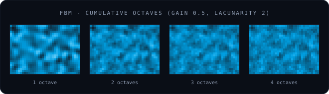

# fBm

`Fbm` sums `octaves` copies of any `Field<P>`, `lacunarity` scaling
frequency and `gain` scaling amplitude per octave:

```rust,ignore
Fbm::FOUR_OCTAVES.at(&Simplex2D, p)
```

Fields are newtypes (`Octaves(u32)`, `Gain(f64)`, `Lacunarity(f64)`),
`serde(transparent)` — `{"octaves":4,"gain":0.5,"lacunarity":2.0}`.
`FOUR_OCTAVES` is the classic 4 / 0.5 / 2.0 configuration.


