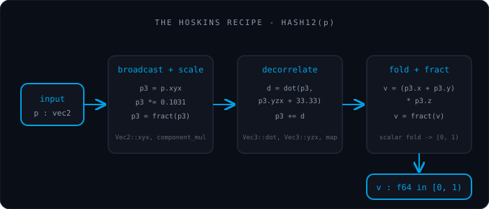
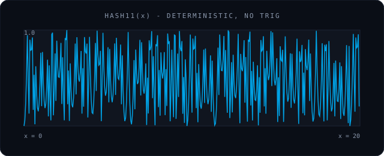

# Hash

`Hash<Out>` is a generic trait: `p.hash()` returns the `Out`-shaped
hash of `p`, every component in `[0, 1)`.

```rust,ignore
let v: f64 = p.hash();        // GLSL hash13
let v: Vec3<()> = p.hash();   // GLSL hash33
let v: Vec4<()> = Hash::<Vec4<()>>::hash(&p); // hash44, explicit
```

The 13 impls mirror the GLSL `hashNN` naming (input dimension × output
dimension) and implement David Hoskins' "hash without sine" recipe
(MIT) — `fract`/multiply/add only, so output is bitwise stable across
platforms. Each impl's rustdoc names its `hashNN` designation.



`fract(x) = x - x.floor()` — exact for negative inputs.

The same recipe rendered by the crate itself — `hash11` over
`[0, 20)`, generated by `examples/render_book_svg.rs`:


