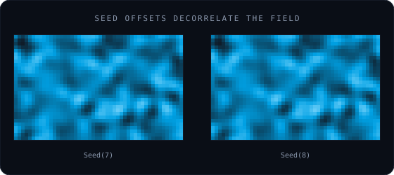

# Seeding

`Seed(u64)` is a serde-transparent newtype. Fields are seeded by
**coordinate offset**, not by re-randomizing the field:

```rust,ignore
let v = Simplex3D.at(p + seed.offset_3d());
let flames = Simplex2D.at(uv + seed.offset_2d());
```

- `Seed::random()` — nondeterministic from the system clock (the
  `Math.random()` equivalent)
- `Seed::mix(&other)` — deterministic decorrelated sibling seed for
  independent fields in one run
- `Seed::as_f64()` — the seed as `[0,1)` scalar


