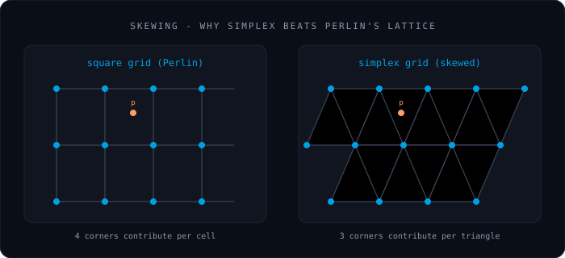
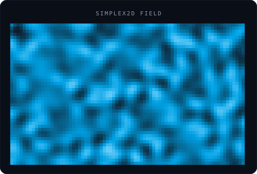

# Simplex

`Field<P>` abstracts a scalar noise field sampled at a point;

```rust,ignore
pub trait Field<P> { fn at(&self, p: P) -> f64; }
```

| Type | Domain | Output |
|---|---|---|
| `Simplex2D` | `Vec2<()>` | `[0, 1]` |
| `Simplex3D` | `Vec3<()>` | `[0, 1]` |
| `Simplex2DFractal` | `Vec2<()>` | ~`[0, 1]` (octave sum) |
| `Simplex3DFractal` | `Vec3<()>` | ~`[0, 1]` (octave sum) |

`Simplex2D` is the Quilez hash-simplex (gradients via `hash22`);
`Simplex3D` is the Miropolskiy variant (gradients via `hash33`,
renormalized `* 0.5 + 0.5` — **not** `[-1,1]`). Both are table-free
and deterministic. The fractal variants rotate the domain between
their four fixed octaves (`mat2(1.6,1.2,-1.2,1.6)` resp. three `mat3`
rotators) to break up directional artifacts.



Skewing squashes the lattice so each cell is a triangle (a tetrahedron
in 3D): three gradient lookups per sample instead of four — and the
trick that makes simplex scale to higher dimensions cheaply.

The field itself, rendered by `examples/render_book_svg.rs` — note
the smooth continuity, no grid-aligned artifacts:


